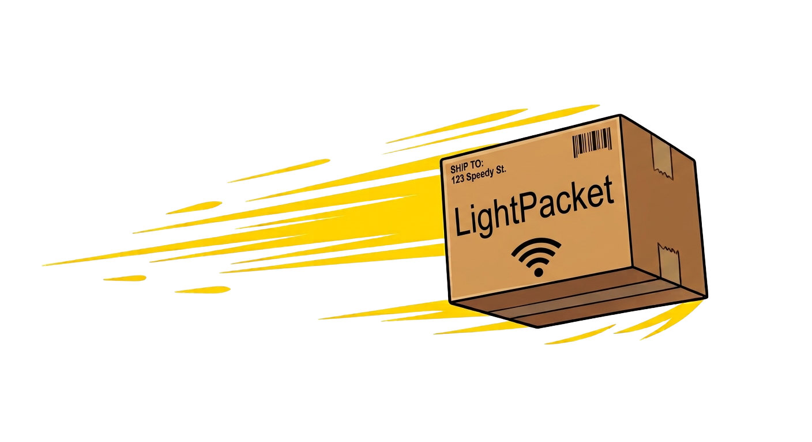

# LightPacket: Packet Manipulation Library

[](https://github.com/Light-Projects/LightPacket)
[](https://opensource.org/licenses/MPL-2.0)
[](https://www.python.org/)

**A Python library
for building, dissecting, capturing, and replaying network packets.**

LightPacket brings packet crafting and network capture into one Python library. Its layered packet model covers traffic from Ethernet and VLAN through IPv4, IPv6, TCP, and UDP, as well as protocols such as ARP, PPPoE, and 802.11. Use it to inspect existing traffic, create packets for testing, capture traffic on a live interface, or work with packet-capture files, all through a consistent API.

LightPacket is designed for network engineers, security researchers, developers, and students who need to work with packets directly from Python. It combines a Scapy-style layering syntax with a built-in packet dissector, a Python cBPF engine, and pure-Python PCAP and PCAPNG file handling.

## Why LightPacket?

- **Build and inspect layered packets.** Compose protocol layers and parse raw frames into structured packet objects.
- **Work with a broad range of protocols.** Supported layers span Ethernet, VLAN, ARP, IPv4, IPv6, TCP, UDP, PPP, and IEEE 802.11.
- **Filter without an external BPF compiler.** The built-in LightBPF engine compiles and evaluates classic BPF filters in Python.
- **Read and write capture files in Python.** PCAP and PCAPNG operations do not require a C compiler or native capture library.
- **Choose a live-capture backend.** Use the cross-platform libpcap/Npcap-backed socket or Linux’s `AF_PACKET` socket, depending on your platform and needs.
- **Capture and replay traffic.** Stream packets from an interface, apply filters, and replay saved captures with configurable timing.

## Capabilities

### Packet construction and dissection

Construct packets by stacking protocol layers with `/`, serialize them to wire-format bytes, and inspect incoming bytes with `DetectLayer`. Packet objects expose their layers and fields for further analysis or processing.

### Protocol coverage

LightPacket supports common Layer 2, Layer 3, and Layer 4 protocols, including Ethernet II, VLAN and QinQ, ARP, LLC, STP, PPP, PPPoE, EAPOL, Linux cooked capture, IPv4, IPv6, TCP, and UDP. IEEE 802.11 layers are available for working with Wi-Fi frames.

### Filtering

LightBPF includes a pure-Python lexer, parser, compiler, disassembler, and virtual machine for classic Berkeley Packet Filter expressions. Filters can be compiled and evaluated offline, or attached to supported Linux sockets using `SO_ATTACH_FILTER`.

### Live capture and sockets

The high-level `Sniffer` supports streaming, callbacks, packet limits, timeouts, and filtering. For sending and receiving Layer 2 frames, LightPacket offers a libpcap/Npcap-backed `L2Socket` and a Linux-specific `AF_PACKET` implementation called `L2Packet`.

Live capture has platform-specific system requirements. On Linux, raw packet access may require elevated privileges; on Windows, Npcap is required for the libpcap-compatible backend. See [Installation](#installation).

### Capture files and replay

The pure-Python capture-file modules support classic PCAP and PCAPNG reading and writing. The replay utility can send packets from PCAP, and PCAPNG files through a socket, with options for pacing, loops, and jitter.

## Installation

LightPacket supports Python 3.8 and later.

### Install from PyPI

```bash
pip install lightpacket
```

### Install from source

```bash
git clone https://github.com/Light-Projects/LightPacket.git
cd LightPacket
pip install .
```

### Live-capture prerequisites

Capture-file reading and writing are implemented in pure Python and do not require libpcap. Live capture uses native platform facilities:

- **Linux:** The libpcap-backed socket requires libpcap. The Linux `L2Packet` backend uses `AF_PACKET`. Raw socket operations may require root or appropriate capabilities.
- **macOS:** Install libpcap, for example with `brew install libpcap`. The Darwin/BSD `L2BPF` backend uses `bpf devices` . 
- **Windows:** Install [Npcap](https://npcap.com/) and select WinPcap API-compatible mode.

## Quick start

Create a packet by stacking layers, then serialize it to bytes:

```python
from LightPacket.l2 import Ethernet
from LightPacket.l3 import IPv4, TCP
from LightPacket.Raw import Raw

packet = (
    Ethernet(dst="aa:bb:cc:dd:ee:ff")
    / IPv4(dst="192.168.1.1")
    / TCP(dport=80, flags=0x02)
    / Raw(b"example payload")
)

wire_bytes = packet.build()
print(f"Built {len(wire_bytes)} bytes")
```

This example constructs a packet; sending raw traffic requires a suitable socket, interface, and permissions.

## Documentation

The README introduces the project rather than documenting every class and field. See the following guides for detailed usage:

- [LightBPF guide](LightBPF/README.md) - filter syntax, compilation, disassembly, and execution.
- [API reference](https://github.com/Light-Projects/LightPacket) - package modules and protocol definitions.

## Project status

LightPacket is an open-source project .

The project’s capabilities and platform support continue to evolve. Check the documentation and issue tracker before relying on a particular protocol layer or live-capture backend in a production environment.

## Tested Platforms

#### - *Windows 10*

#### - *FreeBSD 15.1*

#### - *OpenBSD 8.0*

#### - *NetBSD 11.1*

#### - *DragonflyBSD 6.4*

#### - *Linux Mint 22.3*

## Contributing

Bug reports, feature requests, and contributions are welcome. Please open an issue or pull request in the [LightPacket repository](https://github.com/Light-Projects/LightPacket).

## License

LightPacket is released under the [Mozilla Public License 2.0](LICENSE).

## Main Author

**Adam Boulaaz** - [GitHub](https://github.com/adamboulaaz92-jpg)